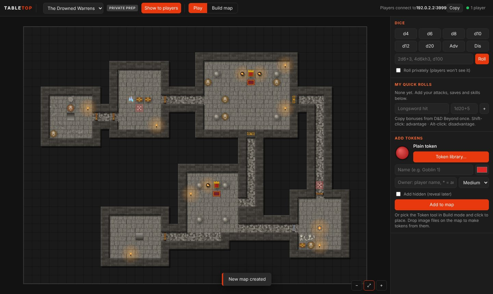
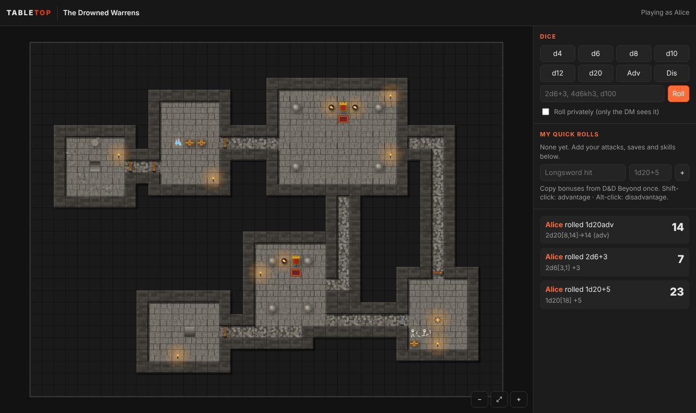

<p align="center"></p>

<p align="center">
  <a href="https://github.com/CPSDomain/VTT/releases/latest"></a>
  
  <a href="CHANGELOG.md"></a>
</p>

<p align="center">
  <b><a href="https://github.com/CPSDomain/VTT/releases/latest">⬇ Download the latest version</a></b> &nbsp;·&nbsp;
  <a href="docs/DM-GUIDE.md">DM guide</a> &nbsp;·&nbsp;
  <a href="docs/PLAYER-GUIDE.md">Player guide</a> &nbsp;·&nbsp;
  <a href="CHANGELOG.md">What's new</a>
</p>

---

**Tabletop** is a virtual tabletop for your own D&D group. The DM runs **Tabletop DM** on their PC: it hosts the game, builds maps and runs the session. Players connect with **Tabletop Player** (or any web browser) over the local network or Tailscale. No accounts, no subscriptions, no cloud: the table lives on the DM's PC.

D&D Beyond stays the character manager; maps, tokens and dice live in Tabletop.


## Download

Get the latest Windows build from the **[Releases page](https://github.com/CPSDomain/VTT/releases/latest)**:

| File | For | How |
| --- | --- | --- |
| `Tabletop-DM-<version>-Windows.zip` | The DM | Unzip anywhere, run **Tabletop DM.exe** |
| `Tabletop-Player-<version>-Windows.zip` | Each player | Unzip anywhere, run **Tabletop Player.exe** |

Nothing to install. The first time, Windows SmartScreen says "Windows protected your PC" because the apps aren't code-signed yet: click **More info → Run anyway**. The DM must also click **Allow** on the firewall prompt so players can connect.

What changed in each version: **[CHANGELOG.md](CHANGELOG.md)**.

## Getting started

1. **DM:** start Tabletop DM. The address players need (e.g. `192.168.1.20:3000`) is at the top right, with a Copy button.
2. **Players:** start Tabletop Player, type that address and your name, and click Connect. Use the same name every session: the DM gives tokens to names.
3. **Playing online?** Everyone installs [Tailscale](https://tailscale.com) (free) and joins the DM's network; players then use the DM's Tailscale address.

Full walkthroughs: **[DM guide](docs/DM-GUIDE.md)** · **[Player guide](docs/PLAYER-GUIDE.md)**

## Features

**Map building**
- **Generate a map in one click:** a village (roads, market square, furnished tavern, smithy, temple and graveyard, shop, stable, houses, fields, river and bridge), a dungeon (rooms, corridors, doors, secret doors, traps, themed rooms) or a forest road (groves, campsite, pond, ruins), with optional villagers or monsters. Reroll until you like it.
- Tools: paint, rectangle, room (floor plus walls in one drag), bucket fill, erase, props, tokens, with undo and redo
- **Select tool:** move, rotate, nudge or delete any prop; box-select part of the map to move it, copy it (Alt-drag or Ctrl+C / Ctrl+V) or clear it
- 14 terrains and 69 props: doors, double doors, secret doors, portcullises, windows, furniture, dungeon dressing, village pieces and nature
- Upload your own battle maps (or drag them on) and line the grid up with them
- Build maps privately, then **Show to players** when ready


**What players see**
- Secret doors, traps and hidden monsters exist only on the DM's screen: they are never sent to players

| DM's view | Player's view |
| --- | --- |
|  |  |

**Tokens**
- A library of 215 ready-made tokens: dragons of every colour, kobolds, goblinoids, humanoids, undead, beasts, giants and monsters, fiends and fey, villagers, farm animals, hero classes
- Upload your own token art (several files at once, or drop images on the map), saved for reuse
- Edit any token: name, art, colour, owner, size. Hide it from players and reveal it later
- Players can move only their own tokens


**Dice**
- Rolled on the DM's PC so nobody can fudge them: `1d20+5`, `2d6+1d4-1`, `4d6kh3`, `1d20adv`, `d100`
- Saved quick rolls per player (copy bonuses from D&D Beyond once), private rolls, natural 20 and 1 highlighted

## Building from source

Needs Node.js 18 or newer.

```bash
git clone https://github.com/CPSDomain/VTT.git
cd VTT
npm install
npm run dm          # run the DM app from source
npm run player      # run the Player app from source
npm run server      # headless server, no window: DM_KEY=secret PORT=3000 node server.js
npm run build:win   # build the Windows zips into dist/
npm run release     # gather the zips and release notes into dist/release/
```

How a new version is cut: [docs/RELEASING.md](docs/RELEASING.md).

### Project layout

| Path | What's there |
| --- | --- |
| `src/` | The game server (Node.js + WebSocket). Owns all game state and checks every action |
| `public/` | The table itself: HTML, canvas rendering, map art, generators, token art |
| `apps/dm`, `apps/player` | The two desktop apps (Electron) |
| `build/` | Packaging config, app icon, token library builder |
| `scripts/` | Release helper |
| `docs/` | Guides and screenshots |

The DM app makes a new secret key each time it starts and gives it only to its own window; that key is what makes a connection the DM. Saves live in `%APPDATA%\Tabletop DM\data` on Windows.

## Credits

Built-in token artwork is from [game-icons.net](https://game-icons.net) by Lorc, Delapouite and contributors, licensed [CC BY 3.0](https://creativecommons.org/licenses/by/3.0/). See [public/CREDITS.txt](public/CREDITS.txt). Map textures and props are drawn in code by Tabletop.
