<p align="center">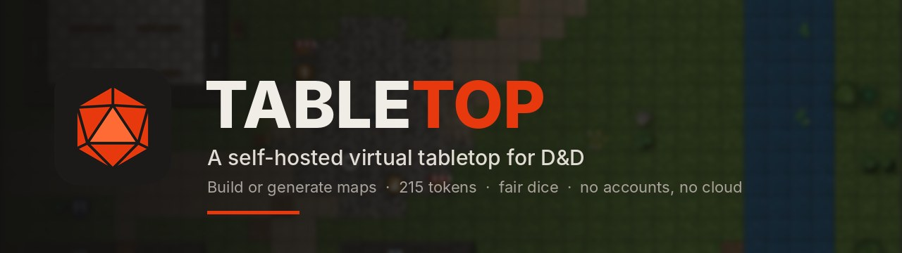</p>

<p align="center">
  <a href="https://github.com/CPSDomain/VTT/releases/latest"></a>
  
  <a href="CHANGELOG.md"></a>
</p>

<p align="center">
  <b><a href="https://github.com/CPSDomain/VTT/releases/latest">⬇ Download the latest version</a></b> &nbsp;·&nbsp;
  <a href="docs/DM-GUIDE.md">DM guide</a> &nbsp;·&nbsp;
  <a href="docs/PLAYER-GUIDE.md">Player guide</a> &nbsp;·&nbsp;
  <a href="CHANGELOG.md">What's new</a> &nbsp;·&nbsp;
  <a href="docs/ROADMAP.md">Roadmap</a>
</p>

---

**Tabletop** is a virtual tabletop for your own D&D group. The DM runs **Tabletop DM** on their PC: it hosts the game, builds maps and runs the session. Players connect to it with **Tabletop Player**, on the same network or over the internet: Tabletop DM opens its port on your router by itself. No accounts, no subscriptions, no cloud: the table lives on the DM's PC.

D&D Beyond stays the character manager; maps, tokens and dice live in Tabletop.

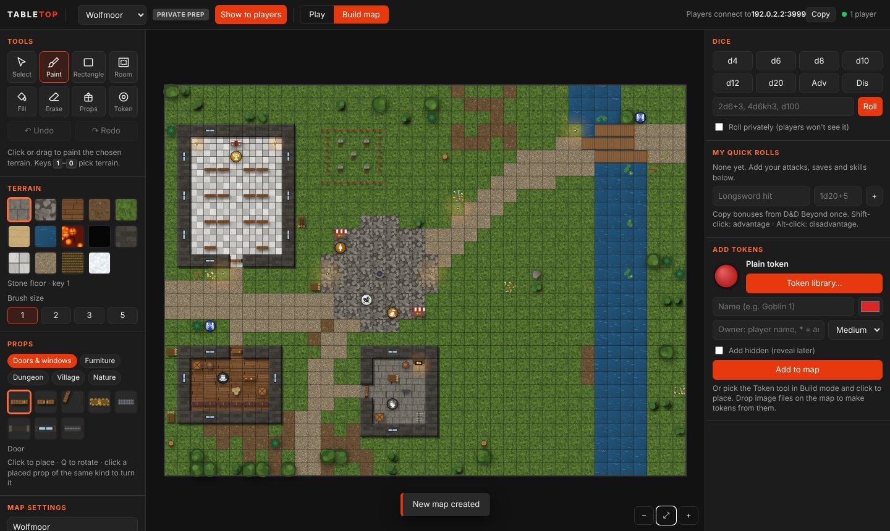

## Download

Get the latest version from the **[Releases page](https://github.com/CPSDomain/VTT/releases/latest)**:

| File | For |
| --- | --- |
| `Tabletop-DM-Setup-<version>.exe` | The DM: Windows installer |
| `Tabletop-Player-Setup-<version>.exe` | Each player: Windows installer |
| `…-Windows.zip` | Windows without installing: unzip anywhere and run the .exe |

The installers need no admin rights and add Start menu and desktop shortcuts. The first time, Windows SmartScreen says "Windows protected your PC" because the apps aren't code-signed: click **More info → Run anyway**. The DM must also click **Allow** on the firewall prompt so players can connect. The apps tell you when there's a new version and install it in one click (**Update now**), keeping your maps and tokens.

What changed in each version: **[CHANGELOG.md](CHANGELOG.md)**. What's coming: **[Roadmap](docs/ROADMAP.md)**.

## Getting started

1. **DM:** start Tabletop DM. The address players need (e.g. `192.168.1.20:3000`) is at the top right, with a Copy button.
2. **Players:** start Tabletop Player, type that address and your name, and click Connect. Use the same name every session: the DM gives tokens to names.
3. **Players somewhere else?** Tabletop DM asks your router to open its port (UPnP). When it has, **🌐 Online** at the top right shows your internet address: give that to players outside your home, and set a table passcode.

Full walkthroughs: **[DM guide](docs/DM-GUIDE.md)** · **[Player guide](docs/PLAYER-GUIDE.md)**

## Features

**Characters from D&D Beyond**
- Players paste their D&D Beyond link and get their portrait, hit points, AC and every roll on their sheet as a button
- They place their own token on the map; the DM sees its AC and passive Perception
- Every 2024 spell, weapon attacks and class features land on the chosen tokens straight away: attacks against AC with Advantage and Disadvantage, saves against the DC, damage, healing, conditions and how they end, concentration, death saves. Monsters cast the spells on their stat blocks too
- Spell areas like Spirit Guardians and Spike Growth hit creatures that move into them; Dodge, Disengage, Help, Hide, opportunity attack alerts, cover, Weapon Mastery, Multiattack, recharge and legendary actions follow the 2024 rules
- The DM makes magic weapons, armour, potions, scrolls, wands and wondrous items and gives them to players, who use them in combat
- Round portrait tokens from any picture, with a frame

**Map building**
- **Describe it, and it's generated:** type *"snowy fishing village on the coast with a lighthouse"* or *"kobold mine with a dragon's lair"* and the generator picks the settings, which you can adjust. Villages (green, snowy, desert or swamp; river, lake or coast; walled towns, hamlets, ruins), dungeons (stone halls, caves, crypts, mines, sewers, temples, lava forges, flooded halls), wilderness (forests, swamps, river crossings, mountain passes, oases, coastlines) and building interiors (taverns, temples, manors, shops, guardhouses, wizard towers). Seeds let you make the same map again.
- Tools: paint, rectangle, room (floor plus walls in one drag), bucket fill, erase, props, tokens, with undo and redo
- **Select tool:** move, rotate, nudge or delete any prop; box-select part of the map to move it, copy it (Alt-drag or Ctrl+C / Ctrl+V) or clear it
- 14 terrains and 69 props: doors, double doors, secret doors, portcullises, windows, furniture, dungeon dressing, village pieces and nature
- **Import from MapTool:** campaigns and maps (map images, stamps, drawings, tokens, labels, revealed fog, vision blocking, lights) and tokens
- **Import maps** from Dungeon Scrawl, Dungeondraft, Dungeon Alchemist and others (Universal VTT: map, grid, walls and doors), or any map image, e.g. from Canvas of Kings; the grid is found automatically
- **Export a map** as one file to share with another DM
- Upload your own battle maps (or drag them on) and line the grid up with them
- Build maps privately, then **Show to players** when ready
- Buildings with floors: stairs take characters up and down, and each player sees their own floor

| Describe it | Get it |
| --- | --- |
| 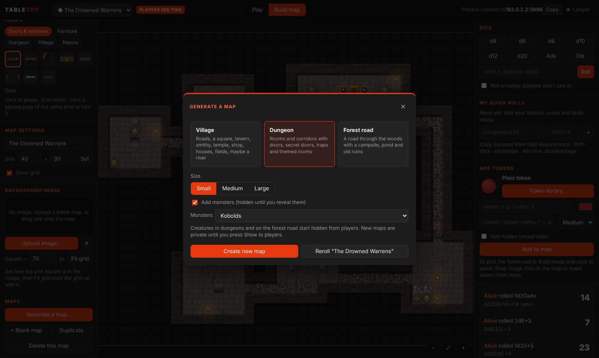 | 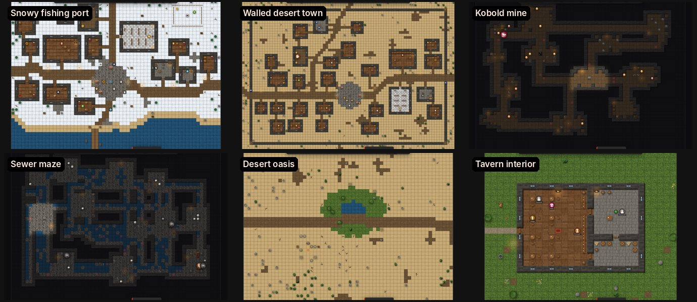 |

**Fog of war, and what players see**
- Turn on fog of war and players see only what you reveal. **Reveal room** opens a whole room with one click, stopping at doors; brushes reveal or cover by hand
- Nothing under the fog, and no secret door, trap or hidden monster, is ever sent to players' screens
- Monsters in the dark are invisible to players until they step into the light, or you reveal their room
- Generated dungeons can start fogged with only the entrance showing

| DM's view | Player's view |
| --- | --- |
| 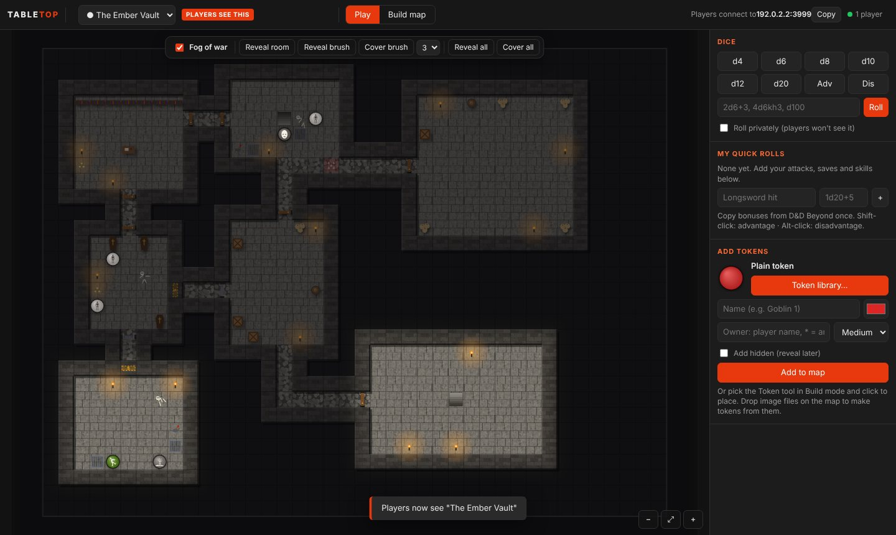 | 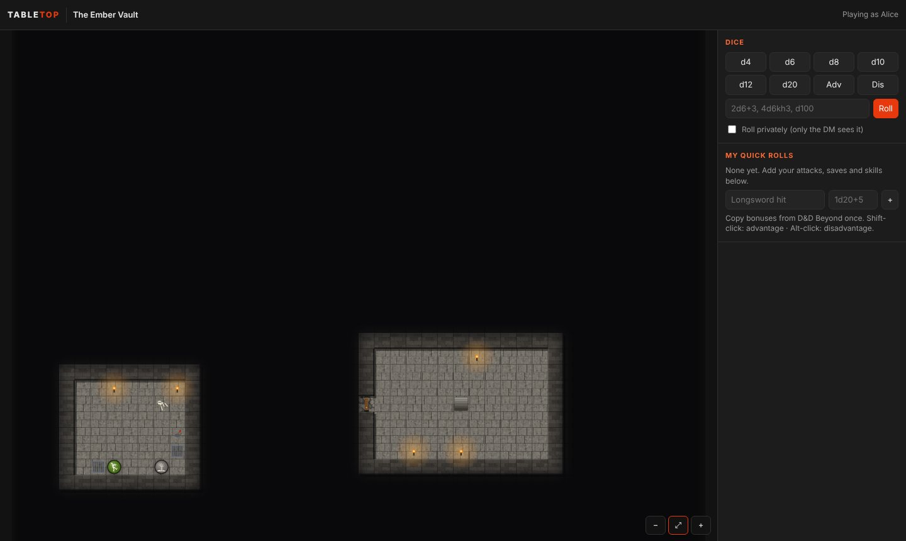 |

**Tokens**
- A library of 215 ready-made tokens: dragons of every colour, kobolds, goblinoids, humanoids, undead, beasts, giants and monsters, fiends and fey, villagers, farm animals, hero classes
- Upload your own token art (several files at once, or drop images on the map), saved for reuse
- Edit any token: name, art, colour, owner, size. Hide it from players and reveal it later
- Players can move only their own tokens

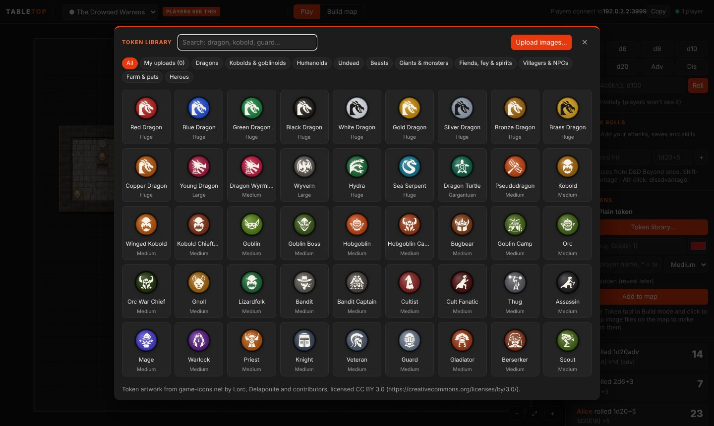

**Lighting and vision**
- Players see only what their characters can see: walls and closed doors block sight, darkness hides what isn't lit
- Torches, braziers and other lights on the map; give tokens a light and darkvision
- Doors players can open and close; with fog of war, the map reveals itself as the party explores
- The DM can preview what the party sees

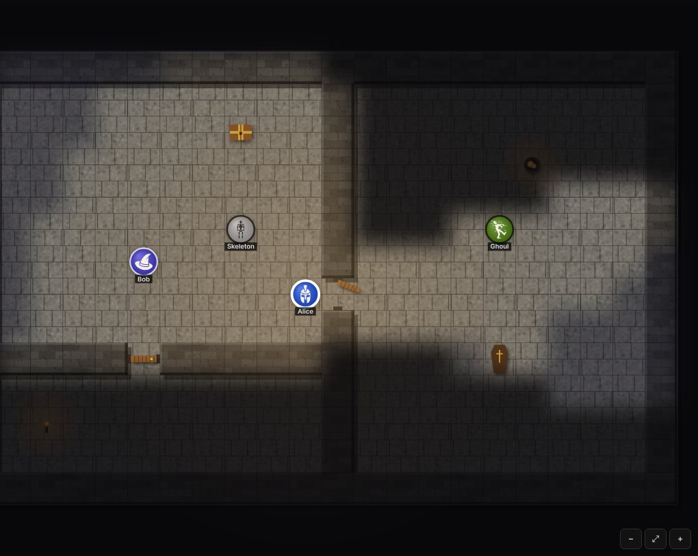

**Talking at the table**
- Chat in the log, with speech bubbles over tokens; whispers to one player or the DM
- The DM speaks as any NPC on the map
- A D&D Beyond link on each character: double-click the token to open the sheet

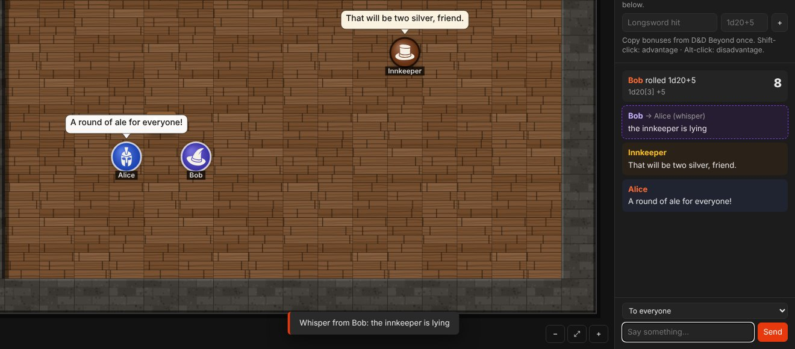

**Handouts**
- Letters, pictures and clues popped up on everyone's screen or just one player's, kept to read again

**Encounters**
- Encounter builder with the 334 SRD monsters: pick a fight for your party's level and see how hard it is, then place it on the map
- Stat blocks with clickable attacks and damage rolls

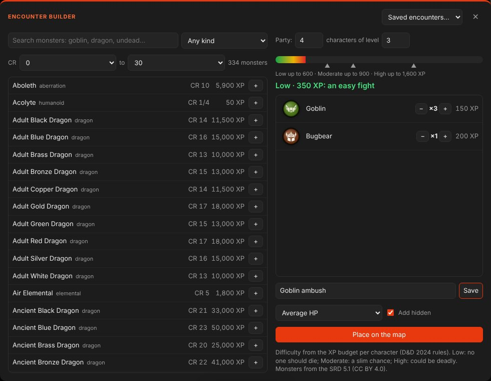

**Combat**
- Initiative tracker: start combat in one click, roll for all monsters at once, players roll their own; turn order, rounds, and whose turn glows on the map
- Hit points with damage and healing buttons, temporary HP, health bars on tokens; choose per token whether players see numbers, a bar, or nothing
- 24 conditions shown as icons on tokens; players manage their own character's HP and conditions
- 88 library monsters come with their standard HP and initiative bonus

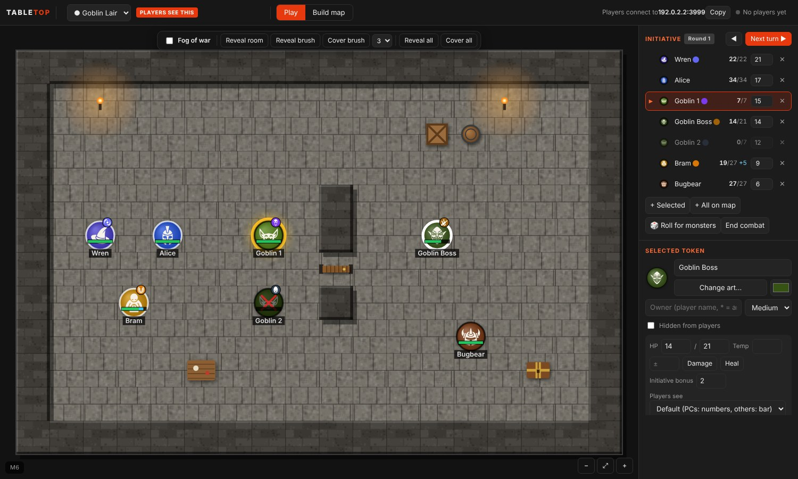

**Table tools**
- Ruler in feet (5e diagonals, or the 5/10/5 variant), with corners; everyone sees who's measuring what
- Dragging a token shows how far it moved
- Spell templates (cone, sphere, cube, line, cylinder) that shade the squares they hit
- Ping a spot for everyone; the DM can pull everyone's view to it
- Map labels for room names, and DM-only notes

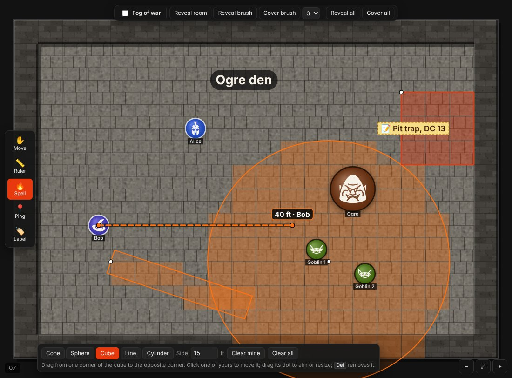

**The look of the map**
- Painted-looking maps: grass, dirt, sand and water blend into each other with natural, uneven edges instead of hard squares; detailed stone, cobbles, wood and marble; scattered grass, flowers, pebbles and cracks; walls with height and shadow; props with shading and shadows. The grid stays for movement and rules
- Caves with rounded natural rock walls (generated caves get them by themselves; any map can switch under **Walls look**)
- Tokens with gold (players) or iron (monsters and NPCs) rims
- Light and darkness: torches, braziers, campfires, lamps and lit tokens throw flickering light, with soft shadows from walls, pillars and trees; dark dungeons and night-time maps are really dark around the light
- Living fire with sparks and smoke, water that ripples, lava that glows and lights the room, dust in the torchlight, fireflies at night
- Purely for looks: what characters can see still follows the vision rules. Slower PCs can keep the light without the movement, or use the classic look

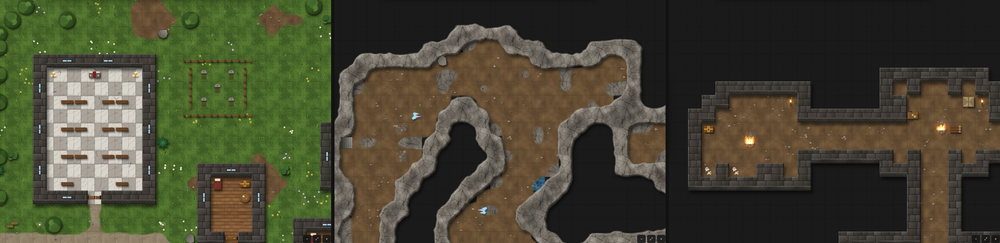

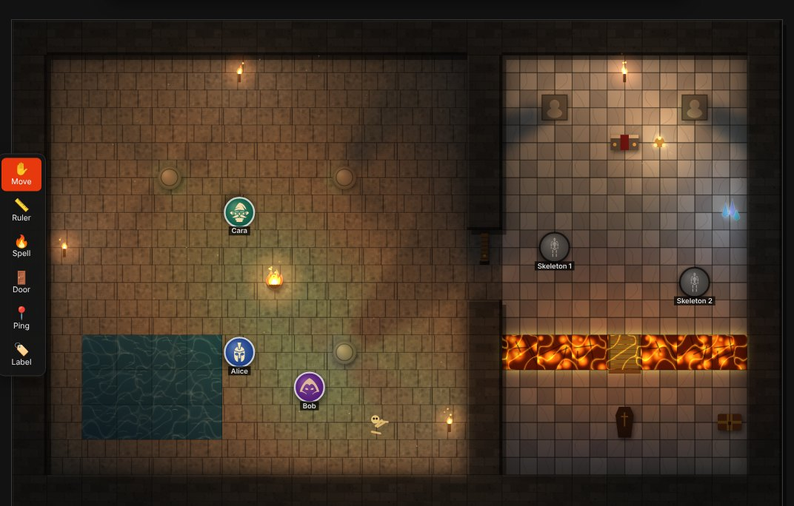

**Immersion**
- Dice that roll across everyone's screen and land on the result; twelve dice sets or a picture of your own. The DM's rolls stay secret
- Spells that go off over their templates (fire, lightning, cold, acid, thunder and more), with sound
- Tokens flinch when hit, glow when healed, fall when they drop, and show conditions such as burning or poisoned
- Sound from the map: torches, fires, water and lava, louder as your character gets closer; doors, blows and footsteps
- Read-aloud text on every player's screen, and a title card when the party arrives somewhere new

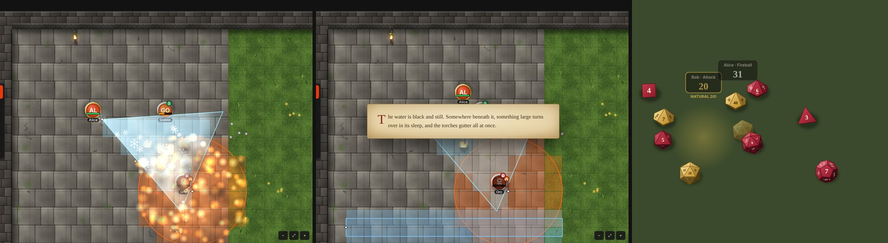

**Atmosphere**
- Music and ambience the DM plays for everyone, in step on every screen: 4 music tracks and 8 ambiences built in (tavern, battle, dungeon, rain, thunderstorm, campfire, cave, ocean…), or upload your own
- Layer up to 5 ambiences under the music, each with its own volume; every player sets their own volume too
- Give a map its own sound, and it starts when you show the map
- Weather on the map (rain, storm with lightning, snow, fog, embers) and dawn, dusk or night, with torches and fires glowing in the dark

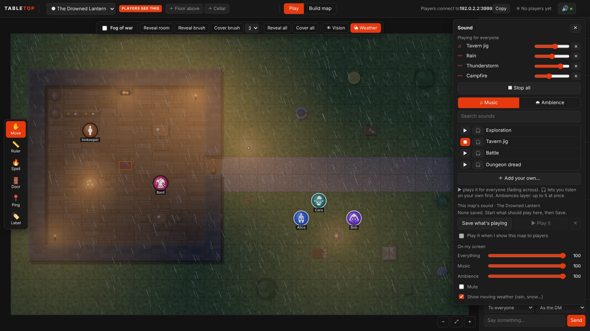

**Running the table**
- Play over the internet without setting up your router: Tabletop DM opens its port by itself (UPnP) and shows the address to give players. Choose the port in the app
- Optional table passcode; players can protect their name with a PIN; remove or block a player
- One-click updates for the DM and Player apps

**Dice**
- Rolled on the DM's PC so nobody can fudge them: `1d20+5`, `2d6+1d4-1`, `4d6kh3`, `1d20adv`, `d100`
- Saved quick rolls per player (copy bonuses from D&D Beyond once), private rolls, natural 20 and 1 highlighted

## Building from source

Needs Node.js 18 or newer.

```bash
git clone https://github.com/CPSDomain/VTT.git
cd VTT
npm install
npm run dm          # run the DM app from source
npm run player      # run the Player app from source
npm run server      # headless server, no window: DM_KEY=secret PORT=3000 node server.js
npm run build:win   # build the Windows zips into dist/
npm run release     # gather the zips and release notes into dist/release/
```

How a new version is cut: [docs/RELEASING.md](docs/RELEASING.md).

### Project layout

| Path | What's there |
| --- | --- |
| `src/` | The game server (Node.js + WebSocket). Owns all game state and checks every action |
| `public/` | The table itself: HTML, canvas rendering, map art, generators, token art |
| `apps/dm`, `apps/player` | The two desktop apps (Electron) |
| `build/` | Packaging config, app icon, token library builder |
| `scripts/` | Release helper |
| `docs/` | Guides and screenshots |

The DM app makes a new secret key each time it starts and gives it only to its own window; that key is what makes a connection the DM. Saves live in `%APPDATA%\Tabletop DM\data` on Windows.

## Credits

Built-in token artwork is from [game-icons.net](https://game-icons.net) by Lorc, Delapouite and contributors, licensed [CC BY 3.0](https://creativecommons.org/licenses/by/3.0/). See [public/CREDITS.txt](public/CREDITS.txt). Map textures and props are drawn in code by Tabletop.

The encounter builder's monsters and stat blocks include material taken from the System Reference Document 5.1 ("SRD 5.1") by Wizards of the Coast LLC, available at <https://dnd.wizards.com/resources/systems-reference-document>, licensed under the [Creative Commons Attribution 4.0 International License](https://creativecommons.org/licenses/by/4.0/legalcode). The data was prepared by the [5e-database](https://github.com/5e-bits/5e-database) project (MIT). Encounter difficulty uses the XP budget per character from the D&D 2024 rules.

Spell descriptions (`public/spells.json`) include material taken from the System Reference Document 5.2 ("SRD 5.2") by Wizards of the Coast LLC, available at <https://dnd.wizards.com/resources/systems-reference-document>, licensed under the [Creative Commons Attribution 4.0 International License](https://creativecommons.org/licenses/by/4.0/legalcode). Spells outside the SRD carry only their game numbers, not their text.

The built-in music and ambiences were made for Tabletop (`build/make-audio.py`); the music is played on the FluidR3 GM soundfont by Frank Wen (MIT licence).
