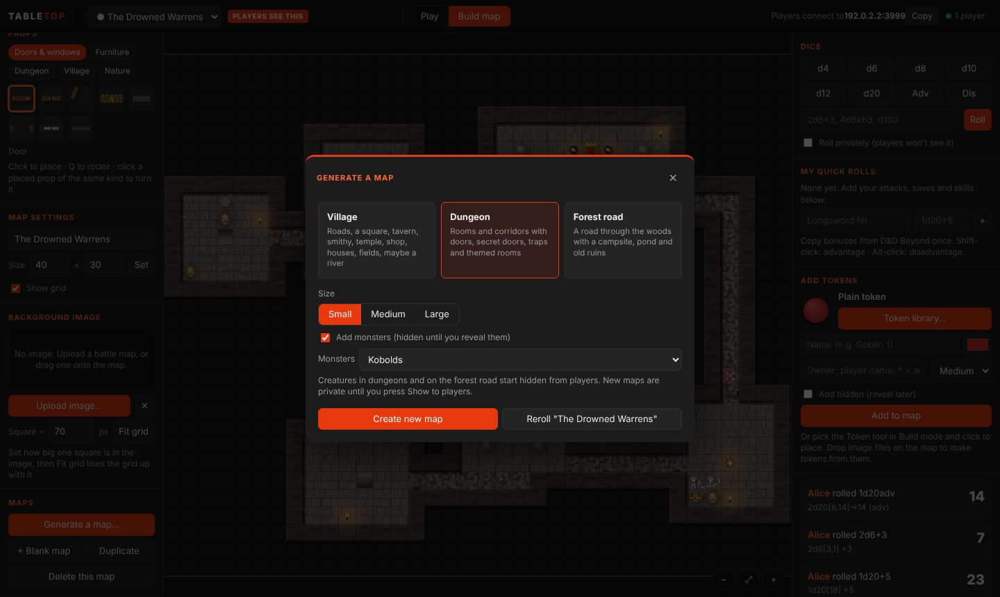
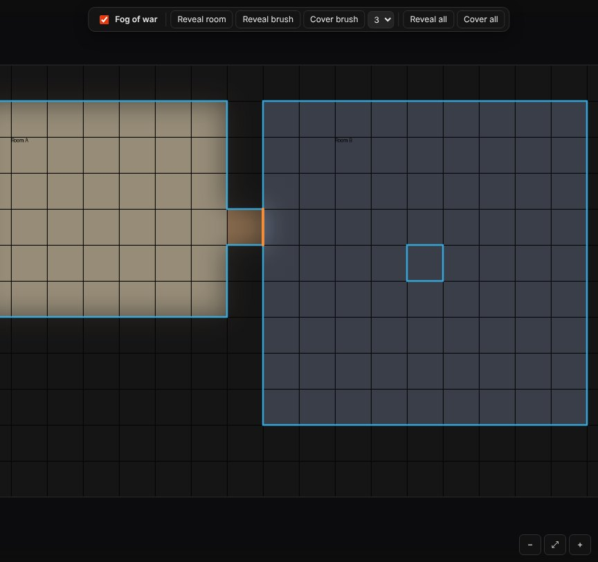
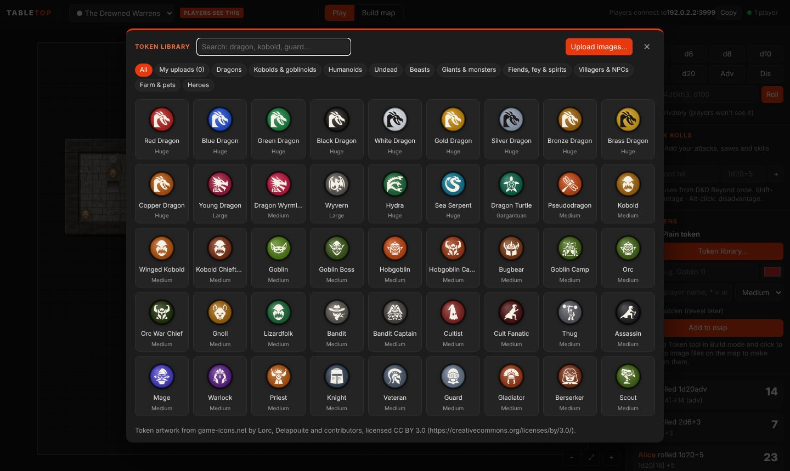
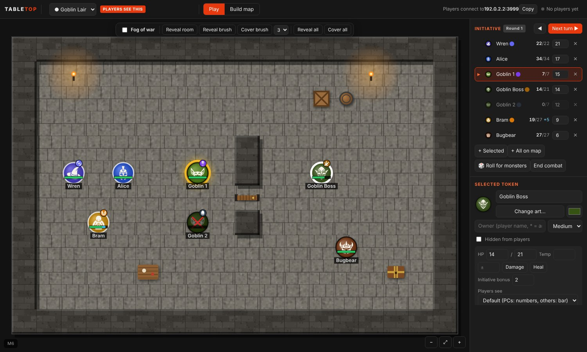

# DM guide

Everything you need to run a session in Tabletop: starting the server, getting players in, building or generating maps, fog of war, and running play.

## Start Tabletop DM

1. Run `Tabletop-DM-Setup-<version>.exe` (no admin rights needed). Choose where to install it (or keep the suggested folder) and click **Install**. It adds Tabletop DM to the Start menu and desktop. Or, without installing: unzip `Tabletop-DM-<version>-Windows.zip` to a folder you'll keep and run **Tabletop DM.exe** from there (keep all the files together).
2. Start **Tabletop DM**.
3. Windows shows "Windows protected your PC" because the app isn't code-signed yet. Click **More info**, then **Run anyway**. This happens once.
4. Windows Firewall asks whether to allow Tabletop DM. Tick **Private networks** and click **Allow**. Without this, players can't reach you.
5. The DM window opens. Top right shows **Players connect to 192.168.x.x:3000**: give that address to your players. The Copy button copies it.

**Updates:** when a new version is out, Tabletop DM tells you once a day (or **Help → Check for updates…**). Download the new installer and run it over the old version.

Your maps, tokens, token library and rolls save automatically to `%APPDATA%\Tabletop DM\data`. **File → Back up table** saves a copy, and **File → Restore from backup…** puts one back (it saves a safety copy of the current table first); **File → Open data folder** shows it. Updating to a new version keeps all of it.

## Get players connected

Each player installs **Tabletop Player** (or unzips `Tabletop-Player-<version>-Windows.zip` and runs **Tabletop Player.exe**), types your address and their name, and clicks Connect. See the [Player guide](PLAYER-GUIDE.md).

The first time you start Tabletop DM, click **Allow** on the Windows firewall prompt. Then give players the address for where they are:

| Players are | Address to give them |
| --- | --- |
| On your Wi-Fi or network | The one shown top right, e.g. `192.168.1.20:3000` |
| Somewhere else (over the internet) | Your internet address, shown by **🌐 Online**, e.g. `41.10.20.30:3000` |

**Playing over the internet.** Tabletop DM asks your router to open its port for it (UPnP), keeps it open while the table runs and closes it again when you quit. Nobody has to set up the router. When it has worked, **🌐 Online** at the top right shows your internet address. (If the router doesn't say what it is, Tabletop asks a public "what's my IP" service.) Tabletop then tries to reach the table at that address: **🌐 Online?** means it couldn't check from inside your network, which many routers don't allow, so test it once: with Tabletop DM running, enter the port at canyouseeme.org, or connect from a phone on mobile data. Set a **table passcode** (below) as well: anyone who has that address can try to join.

If it shows **🌐 Not reachable online** instead, click it to see why. The usual reasons:
- **UPnP is off in your router.** Turn it on in the router's settings and click **Try again**, or forward the port (TCP) to your PC by hand: the panel shows the port and your PC's address.
- **There's a second router in front of yours** (for example the internet provider's box): forward the port on that one too, or set it to bridge mode.
- **Your internet provider shares one address between customers** (carrier-grade NAT, common on mobile and some fibre connections). Port forwarding can't work then; ask your provider for a public IP address.

**Choosing the port.** The table uses port 3000 unless you change it: click the players count at the top right and, under **Connection**, type another port (1024 to 65535) and click **Change**. The table moves there straight away (players reconnect with the new address), the router is updated, and the port is remembered. Untick **Open the port on my router automatically** to play on your network only.

To test alone, run Tabletop Player on the same PC and connect to `localhost:3000`.

## Who can join

Click the players count at the top right (e.g. **2 players**) for **Who can join**:

- **Table passcode:** type one and click Save. Players then need it to join; the Player app asks for it. Clear it and Save to remove it. A 🔒 by the players count shows one is set. Players already at the table stay connected.
- **Remove** disconnects a player. They can join again (with the passcode, if there is one).
- **Block** disconnects them and stops anyone joining under that name until you **Unblock** it in the same panel.
- **Names protected by a PIN:** players can protect their name with a PIN (they click **Playing as …** on their screen). Nobody else can then join as them. If someone forgets their PIN, click **Reset PIN** here; they can set a new one.

## Private prep vs what players see

The dropdown at the top picks which map **you** are looking at.

- A red **PLAYERS SEE THIS** badge means every change shows on players' screens live.
- A grey **PRIVATE PREP** badge means only you see this map. Build in peace.
- When a map is ready, click **Show to players**.

## Buildings with floors

A tower, a manor, a dungeon with levels: click **＋ Floor above** or **＋ Cellar** next to the map list at the top. The map becomes a building: the new floor is a blank map of the same size (build it, generate it or import a map image for it) with its own walls, fog and lights. The floor buttons switch between floors; **＋▲** and **＋▼** add more.

- **Stairs:** put stairs, a ladder or a trapdoor on both floors. When a character is dropped on one, they're offered "Up to …" or "Down to …".
- **Moving any token:** select it and pick another floor in the **Floor** box.
- **What players see:** each player sees the floor their character is on, so the party can split up. Players without a character in the building see the floor you showed with **Show to players**. Other floors of that building are marked **IN PLAY**: changes there show to players on them straight away.

## Fog of war

The bar at the top of the map controls fog for the map you're on.

1. Tick **Fog of war**. Players now see nothing until you reveal it; you see everything, with unrevealed areas shaded.
2. **Reveal room:** click inside a room. It reveals the room and its walls and stops at doors, so the party opens one room at a time. Hover first to see what will open. Works on built and generated maps; on an uploaded image map, use the brush.
3. **Reveal brush** / **Cover brush:** paint to reveal, or to cover an area again. Pick the size (1, 3, 5 or 9 squares) next to them.
4. **Reveal all** / **Cover all** do the whole map. Press **Esc** to put the fog tool down and go back to moving tokens.

Nothing under the fog is sent to players' screens. Monsters standing in fog are invisible to players and appear when they walk into a revealed area or you reveal theirs, so with fog on you rarely need **Hidden from players**. Players always see their own tokens.

Generated maps can start fogged with only the way in revealed (the **Start with fog of war** box; on by default for dungeons).

## Lighting and vision

Click **👁 Vision** in the bar at the top of the map:

1. Tick **Players see only what their characters can see.** Each player now sees through the tokens they own: walls and closed doors block their sight, and anything they can't see right now is shown dark. Monsters out of sight aren't sent to their screens at all.
2. Set **Light on this map**: **Bright** (daylight, a lit hall), **Dim** (twilight) or **Dark**. In the dark, characters see only lit squares, plus what their darkvision reaches (as dim light).
3. **Party shares vision** (on by default): every player sees what any party member sees. Untick it for each player to see only through their own tokens.
4. With **Fog of war** on too, **what they see stays revealed**: the map uncovers itself as the party explores, so you don't reveal rooms by hand. Untick it to keep revealing yourself.
5. **Show me what's seen by** previews the map as the whole party or one player sees it. Monsters they can't see show faded. Set it back to **Nobody** to see everything again.

**Lights:** torches, braziers, campfires, fireplaces, candles and lamp posts give light; so do lights brought in with a Universal VTT map. To give a character a light, select the token and pick one under **Light** (candle 5/10 ft, torch 20/40 ft, lamp, lantern, the Light spell, Daylight). Set **Darkvision** the same way (30 to 120 ft). Players can set both on their own characters.

**Doors:** the 🚪 **Door** tool (`D`) opens and closes a door: click it. Closed doors block sight, open ones don't. Players can use it on doors they can see. On an imported Universal VTT map you see its doors while the tool is on: orange closed, green open.

Players need a token of their own to see anything with vision on: give each player's token their name as owner.

## Chat, whispers and NPCs

The chat box is at the bottom of the right-hand panel. Type and press Enter: it goes in the log with the rolls, and a speech bubble shows over the speaker's token.

- **Speak as an NPC:** pick **As the Innkeeper** (any token on the map with no owner) or **As the Narrator** in the second box. Players see the NPC's name, and the bubble appears over that token. **As the DM** speaks as yourself.
- **Whisper:** pick a player under **To**, or type `/w Bob the ring is cursed`. Only they see it (with a pop-up). You see every whisper, including players whispering to each other.
- `/r 2d6+3` rolls from the chat box.

**Character sheets:** select a player's token and paste their D&D Beyond character link (e.g. `https://www.dndbeyond.com/characters/12345678`) in the token panel. Then 📜 Sheet, the 📜 in the initiative list, or double-clicking the token opens it in the browser. Players can set their own.

## Handouts

Letters, wanted posters, a map of the region: under **Handouts** in the right-hand panel, click **+ New handout**. Give it a title, type the text and/or add a picture, and choose **Everyone** or tick the players it's for. **Save and show** pops it up on their screens straight away; **Save** keeps it for later. Players keep it in their Handouts list to read again. **Show** pops it up again; **Edit** changes it, who gets it, or deletes it.

## Generate a map

Click **Build map**, then **Generate a map…**.

1. **Describe the map** in the box at the top, in plain words: *"a snowy fishing village on the coast with a lighthouse"*, *"flooded crypt full of zombies with secret doors"*, *"bandit ambush on a forest road"*, *"a busy tavern called The Rusty Anchor"*. Under the box, **Understood** shows what it picked up, and the matching settings below light up. Stuck for ideas? Click **Example**.
2. **Adjust anything** below: the type (Village, Dungeon, Wilderness, Building) and every setting. Typing in the description again re-reads it from scratch.
3. Click **Create new map**. It opens privately, and a message sums it up. Not right? **Reroll** makes a new one in place.

The description box reads key words (snowy, coast, walled, ruined, crypt, kobolds, swamp, tavern…) rather than whole sentences, and works without internet. Add *"called …"* to name the map.

| Type | Settings |
| --- | --- |
| Village | Setting (green, snowy, desert, swamp) · water (river, lake, coast) · layout (crossroads, one street, hamlet, walled town) · buildings · condition (thriving, lived in, ruined, with raiders) · trees · market, temple and graveyard, farms, mill, watchtower or lighthouse, docks, villagers |
| Dungeon | Style (stone halls, natural caves, crypt, mine, sewer, temple, lava forge, flooded) · rooms · corridor width · linear, branching or maze-like · traps · secret doors · boss room · monsters (goblins, kobolds, orcs, undead, beasts, cultists, bandits, or to suit the style) |
| Wilderness | Forest road, clearing, swamp, river crossing, mountain pass, desert oasis, snowy woods or coastline · cover · road · campsite, ruins, pond, cave entrance, shrine, wagon wreck · creatures |
| Building | Tavern or inn, temple, manor house, shop, guardhouse, wizard tower · size · lived in or abandoned · yard · people inside |

**Seeds:** after generating, the dialog shows the map's seed. Type that seed (with the same settings) to make exactly the same map again, for example to rebuild a map you deleted.

Monsters stay out of players' sight: under the fog until you reveal their area, or marked hidden if fog is off. Dungeons start fogged by default (the **Start with fog of war** box). Everything generated can then be edited with the normal tools: use Select to drag a box round a building and move it, or click any prop to move or delete it.

## Import a map

Made the map somewhere else? Click **Build map**, then **📥 Import map…** under Maps, or drag the file onto the map. It opens as a new private map.

| From | Export it as | What comes in |
| --- | --- | --- |
| **MapTool** | The campaign file (`.cmpgn`), or File → Export → **Map** (`.rpmap`) | Every map: map image, stamps and drawings (one picture), tokens with images, sizes and lights, GM-layer tokens hidden, labels, revealed fog, vision blocking as walls, Day/Night vision |
| **MapTool tokens** | Right-click a token → **Save As** (`.rptok`) | Goes into your token library (My uploads) |
| **Another Tabletop** | Build map → **📤 Export map** (`.ttmap`) | The whole map: images, walls, props, tokens, labels, notes and fog |
| **Dungeon Scrawl** | Export → **Universal VTT** (`.uvtt`, Pro) | Map, grid, walls and doors |
| **Dungeondraft, Dungeon Alchemist**, other map makers | **Universal VTT** (`.dd2vtt`, `.df2vtt`, `.uvtt`) | Map, grid, walls and doors |
| **Canvas of Kings** | Export → **PNG** or **WebP**, with the **square grid** turned on | The map; the grid is found from the lines |
| Dungeon Scrawl (free), Inkarnate, anything else | PNG, JPG or WebP | The map; the grid is found if it has grid lines |

**Walls:** with a Universal VTT map, **Reveal room** follows its walls: turn on Fog of war, pick Reveal room and click inside a room. It reveals the room and stops at walls and doors. In Build mode (and while using Reveal room) you see the imported walls in blue and doors in orange; players never receive them.

**Images:** Tabletop looks for grid lines and sizes the map so the squares match, and tells you what it found. If it couldn't find a grid (or got it wrong), open **Background image**, type how many pixels one square is in the image and press **Fit grid**. Exporting from Canvas of Kings with the square grid showing gives the best result. Hex grids aren't supported yet.

**MapTool:** a campaign with several maps becomes several Tabletop maps. MapTool maps have no edges, so each map is cut to what's on it (up to 200 × 200 squares). Fog of war comes across as it was (what had been revealed stays revealed), vision blocking becomes walls for line of sight and Reveal room, token lights and darkvision come across, and drawings are painted into the map. A campaign file brings its own light sources; a single `.rpmap` doesn't carry them, so lit tokens get a torch. Not imported: macros, token properties other than HP, GM-layer drawings and spell templates. Hex grids come in as squares. If something's missing or out of place, keep the MapTool file: it helps to improve the import.

**Sharing a map:** **📤 Export map** saves the map you're on, with its images, as one `.ttmap` file. Another DM imports it with Import map; it opens as a new private map.

Maps can be up to 200 × 200 squares, and images up to 100 MB.

## Build a map by hand

In **Build map** mode the tools are on the left; one square is 5 ft. The line under Undo/Redo says what the current tool does.

| Tool | Key | What it does |
| --- | --- | --- |
| Select | V | Drag tokens. Click a prop to move it, rotate it (Q), nudge it (arrows) or delete it (Delete). Drag a box over part of the map to select it: drag to move (hold Alt to copy), Delete to clear, Ctrl+C / Ctrl+V to copy and paste |
| Paint | B | Paint terrain; brush size 1, 2, 3 or 5 |
| Rectangle | R | Drag to fill a rectangle with the chosen terrain |
| Room | M | Drag a rectangle: floor inside, walls round the edge |
| Fill | G | Bucket-fill a connected area |
| Erase | E | Removes a prop if there is one, otherwise the terrain |
| Props | P | Click to place; Q rotates; clicking a placed prop of the same kind turns it |
| Token | K | Click to place a token set up in the Add tokens panel |

**Terrains** (keys 1–0 for the first ten): stone, cobblestone, wood, dirt, grass, sand, water, lava, pit, wall, marble, gravel path, farmland, snow.

**Props** come in five tabs (69 in all): Doors & windows, Furniture, Dungeon, Village, Nature.

**Secret doors and traps are visible to you only.** Put a secret door on a wall square. When the party finds it, erase the prop and paint floor plus a normal door.

A quick dungeon by hand: the Room tool for each chamber, Rectangle with cobblestone for the corridor, Paint with stone over the walls where the corridor meets them, then a Door prop in each gap.

**Using an existing battle map:** under Background image, click **Upload image** or drag a PNG or JPG onto the map. The grid sizes itself if the image uses a common square size (70, 100, 140 px…). If the lines don't match, type the image's pixels per square and click **Fit grid**. You can paint and place props on top.

Ctrl+Z undoes, Ctrl+Y redoes. Pan with right-drag or Space+drag, zoom with the mouse wheel, press Home to fit the map.

## Players' characters from D&D Beyond

Players can bring in their own characters: under **My character** in Tabletop Player they paste their D&D Beyond link, and **📍 Put my token on the map** places their token with portrait, hit points, initiative bonus and darkvision. Their sheet's rolls become buttons on their screen. Your PC fetches the character, so it needs the internet, and the character must be public on D&D Beyond. You see the character's AC, passive Perception and speed when you select its token. You can still move, edit or delete their tokens as usual.

If a character comes in wrong (a number that doesn't match D&D Beyond), what D&D Beyond sent is saved in the `dndbeyond` folder inside the data folder (**File → Open data folder**): send that file along with the report.

## Tokens

Click **Token library…** in the right-hand panel: 215 ready-made tokens in categories, searchable by name. Click one, then **Add to map** (it lands in the middle of your view) or use the Token tool to click it into place. Each comes at a sensible size (dragons are Huge). Names count up by themselves: Goblin 1, Goblin 2…

- **Your own token art:** in the library, click **Upload images…** (pick many at once), or drag image files onto the map in Play mode. They're kept under **My uploads**. Token packs you've bought work this way.
- **Owner** decides who can move a token: a player's name (only them, and you), `*` (anyone), or empty (only you: monsters and NPCs).
- **Click any token** to edit it in the Selected token panel: name, art, colour, owner and size. **Duplicate** copies it with the next number. Delete removes it.
- **Hidden from players:** a hidden token shows faded with a dashed ring on your screen only. Untick to reveal it. Tick **Add hidden** before adding to place an ambush.

## Encounters

Click **⚔ Encounter builder…** under Add tokens.

1. Find monsters on the left: search by name or kind (goblin, dragon, undead) and set the challenge ratings. Click a name for its stat block; click **+** to add it.
2. Set the party on the right: how many characters, and their level. The meter shows how hard the fight is, using the D&D 2024 XP budget: **Low** (no one should die), **Moderate** (a slim chance someone dies), **High** (could be deadly) or beyond.
3. **Place on the map** puts the monsters near the middle of your view, on free squares, numbered (Goblin 1, Goblin 2…), with average or rolled hit points and their initiative bonus. **Add hidden** keeps them out of sight until you reveal them.
4. **Save** keeps the encounter (give it a name) to place again later from **Saved encounters…**.

**Stat blocks:** select a monster on the map and click **📖 Stat block**. Attack bonuses, damage, hit dice and ability scores are buttons that roll; your rolls stay private unless you tick **Show rolls to the players**. Library tokens named like an SRD monster ("Goblin 3") have one too.

The monsters are the SRD 5.1 monsters (334, from Aboleth to Zombie), used under the Creative Commons Attribution 4.0 licence.

## Combat

**Start:** click **⚔ Start combat** at the top of the right-hand panel. Every token on the map joins; remove anyone who isn't fighting with ✕, or add more later with **+ Selected** (or **⚔ Add to initiative** on a selected token).

**Roll initiative:** **🎲 Roll for monsters** rolls 1d20 + initiative bonus for every monster without a score (your rolls stay private). Players click 🎲 next to their name or type their score; you can type anyone's. The list sorts itself, highest first.

**Run turns:** **Next turn ▶** moves down the list and starts the next round at the bottom; **◀** goes back. Whose turn it is glows gold on the map. Click a name to select that token and bring it into view. **End combat** (click twice) clears the tracker.

**Hit points:** select a token to see its HP box. Library monsters come with their standard HP and initiative bonus; for others, type HP and max HP. To hurt or heal, type the amount and press **Damage** or **Heal** (Enter = damage, Shift+Enter = heal). Temporary HP soaks damage first. At 0 HP a token is darkened and crossed out.

**What players see of HP** is set per token under **Players see**: HP numbers, a health bar only, or nothing. By default player characters show numbers and everything else shows a bar.

**Conditions:** click the icons under Conditions to toggle them; they appear on the token and in the initiative list.

**Players** click their own token to get the same HP box for their character: they can track their own damage, temp HP, initiative bonus and conditions (but nobody else's). Monsters they can't see (hidden, or in the fog) don't appear in their initiative list.

## Table tools

The bar on the left of the map in Play mode has the tools you and the players use during play. `Esc` always goes back to **Move**.

| Tool | Key | What it does |
| --- | --- | --- |
| Move | V | Drag tokens. Dragging a token shows how far it has moved; press `Space` mid-drag to add a corner |
| Ruler | R | Drag to measure in feet; `Space` adds a corner. Everyone sees it while you measure |
| Spell | T | Spell templates: cone, sphere, cube, line, cylinder (see below) |
| Door | D | Click a door to open or close it (see Lighting and vision) |
| Ping | P | Click to flash a spot for everyone. `Shift`+click also moves everyone's view there. `Alt`+click pings with any tool |
| Label | L | Text on the map, and notes only you can see (see below) |

**Diagonals:** by default every square counts 5 ft, diagonals too (the 5e rule). For the 5 / 10 / 5 variant, set **Ruler diagonals** in Build map → map settings. It's per map.

**Spell templates:** pick the shape in the bar at the bottom of the map. Drag from where the spell starts and let go: the drag sets the direction and size (a sphere's or cylinder's drag sets its radius; a cube goes from one corner to the opposite one). Or type the size and just click. The squares it covers are shaded. Click a template to select it: drag to move it, drag its dot to re-aim or resize, `Del` removes it. You can change or remove anyone's; **Clear all** removes every template on the map. Players' templates are in their own colour, with their name when selected.

**Labels and notes:** with the Label tool, click the map, type the text, pick a size and press Enter. Tick **DM note** for something only you see (shown as a yellow sticky note): trap DCs, what's in the chest, reminders. Drag a label to move it; click it to edit or delete it. With fog of war on, players see a label once its square is revealed.

Players' moves and rulers show on your screen too. Your own token moves aren't shown to players, so dragging a monster in the dark gives nothing away (your ruler and pings are shown).

## Dice

Everyone rolls in the right-hand panel: the die buttons, or type any roll such as `2d6+3`, `4d6kh3` or `d100`. Rolls happen on your PC, so nobody can fudge them.

- **The dice roll on screen:** real dice tumble across the map and land on the result, with the total, a golden burst for a natural 20 and a red one for a natural 1. Dice dropped by advantage or `kh`/`kl` fade out.
- **Who sees what:** a player's roll rolls on everyone's screen. A player's private roll (**Roll privately**) shows only on their screen and yours. **Your rolls are yours alone:** nobody else sees them, on screen or in the log. To show one to the table, tick **Show this roll to the players** first.
- **My dice…** under the dice buttons: pick a set (Ivory, Obsidian, Ruby, Gold, Frost, Ember and more) or **Use a picture…** of your own; everyone sees your dice in your colours. Untick **Show dice rolling on my screen** to keep only the log.

Each player can save **quick rolls** (e.g. "Longsword hit" `1d20+5`), copying bonuses from D&D Beyond once. Shift-click rolls with advantage, Alt-click with disadvantage. Natural 20s show green, natural 1s red.

## Sound and story

**Sounds from the map.** Torches and braziers crackle, campfires and fireplaces burn, water runs and lava bubbles, louder the closer you are: players hear the map from their character, you from the middle of your view. Doors creak open and thud shut, weapons strike when a token loses hit points, healing chimes, and footsteps follow tokens across stone, wood, grass, dirt and water. Each screen sets its own levels under **🔊**: **Map sounds** for the torches, fires, water and lava (0 turns them off), **Effects** for the rest.

**Read aloud.** Type a description in the chat box and click **📜** instead of Send: it appears in the middle of every player's screen like a page from a book, with the sound of parchment, and stays long enough to read (a click closes it). It goes in the log too.

**Scene changes.** When you show players a different map, their screens fade to black and show its name, then fade in on the new place. Name your maps for it ("The Drowned Hall", "Tomb of the Ash King").

## Spells and hits

- **Spell effects:** with the **Spell** tool, pick an effect in the bar (🔥 Fire, ⚡ Lightning, ❄ Cold, 🧪 Acid, 💥 Thunder, 💀 Necrotic, ✨ Radiant, ☠ Poison, 🔮 Force, 🧠 Psychic, 💚 Healing) before placing a template. It goes off for everyone with its sound: a fireball bursts and burns, lightning crackles along its line, cold frosts the cone. Click a template and **Cast** to set it off again. Players can do the same with theirs.
- **Hits and healing:** when a token loses hit points it flinches with a red flash and a blow; healing glows green. Players see the numbers only for tokens whose numbers they're allowed to see.
- **Down:** a token at 0 HP falls over in a pool of blood. Prone, unconscious and dead tokens lie down too.
- **Conditions you can see:** burning tokens flicker with flame, poisoned ones turn green, raging ones glow red, blessed ones gold, hasted ones blue; concentrating gets a turning ring, frightened ones tremble, invisible ones shimmer faintly, petrified ones turn grey and bleeding ones drip.

## The look of the map

Since 1.7, maps are painted rather than built from hard squares. Grass, dirt, sand, snow, water, lava and pits blend into their neighbours with natural, uneven edges; built floors (stone, wood, marble, cobbles) stay straight. Water darkens towards its banks, walls show their height with a shadow and a front face, and props have shading and a shadow. The grid stays exactly as before for movement, the ruler and spells: only the drawing changed, so every map you already have gets the new look.

- **Walls look** (under **Map settings** in Build mode): **Built** walls of cut stone, or **Natural rock** with rounded edges, for caves. Generated natural caves get natural rock by themselves.
- **Big maps** are drawn in blocks in the background. When you jump to a new part of a big map, it can show the plain square drawing for a moment until the new art is ready. After you paint, the old drawing stays up for a moment until the changed part is redrawn.
- **Picture maps** (imported images) look exactly as before.

On top of that, maps are drawn with light and darkness. Torches, braziers, campfires, fireplaces, candles, lamp posts, glowing crystals, lights on tokens and the lights that come with imported maps all give flickering light that fades with distance, using the same ranges as the rules (a torch is bright to 20 ft, dim to 40 ft). Walls, closed doors and imported walls block the light; pillars, statues, trees and tents cast soft shadows. Flames move and throw sparks, braziers and campfires smoke, water ripples, lava glows and lights the room around it, dust floats in the torchlight, and fireflies come out at dusk and night. Tokens cast a shadow away from the nearest light and are shaded by the light they stand in.

How dark the map is comes from two settings: **Light on this map** under **👁 Vision** (bright, dim or dark) and the time of day under **🌦 Weather** (dawn, dusk or night). A bright map in daylight looks as it always has, with the fires alive.

- **It's only the look.** What characters can see is still decided by vision, exactly as before: the shadows from pillars or trees never hide anything. On a player's screen, light shows only where their character can see.
- **You see the dark a little lifted**, so you can still make out the layout and every token. **Build mode** is always in daylight.
- **Slower PCs:** under **🔊 → On my screen → Map look**, choose **Lit, nothing moving** (the light and shadows without the movement) or **Classic** (the look before 1.6). Each player can choose for their own screen.

## Music and ambience

Click **🔊** at the top right. Everything you play here plays on every player's screen too, at the same moment of the track.

- **♫ Music:** click **▶** on a track to play it. Picking another fades across to it. **■** stops it.
- **🌧 Ambience:** **▶** adds a layer (rain, campfire, a river…) under the music. You can have up to 5 at once.
- **Playing for everyone** lists what's on, with a volume slider for each. **✕** fades one out, and **■ Stop all** fades out the lot.
- **🎧** plays a sound on your screen only, so you can check it before the players hear it.
- **＋ Add your own…** uploads sound files from your PC: MP3, OGG, WAV, M4A or FLAC, up to 100 MB each. They go in the list you're looking at (music or ambience); **→♫ / →〰** moves one across, **✎** renames it, **🗑** removes it. Long tracks stream, so whole albums are fine. A short loop made to repeat (like the built-in ones) loops without a gap.
- **This map's sound:** set up what should play on a map, then **Save what's playing**. **▶ Play it** brings it back any time. Tick **Play it when I show this map to players** and it starts by itself when you click **Show to players**: the tavern music when the party walks in, cave drips in the dungeon.
- **On my screen** sets your own volume (everything, music, ambience) without changing it for anyone else. Players have the same sliders.

The Player app plays the sound straight away; players don't need to do anything.

## Weather and time of day

Click **🌦 Weather** in the bar above the map. Pick **Rain**, **Storm** (rain with lightning), **Snow**, **Fog** or **Embers** (a burning town, a volcano), and **Light**, **Medium** or **Heavy**. Pick **Dawn**, **Dusk** or **Night** to colour the map. At those times, torches, braziers, fires, lamps and tokens with a light glow warmly in the dark. **▶ Play matching sound** adds the ambience that goes with it, such as rain for rain or crickets at night.

It's set per map and players see it straight away. It's only a look: for a real night, where characters see only what's lit, also set the light to **Dark** under **👁 Vision**. Weather is hidden while you're in Build mode, and players can turn the moving weather off on their own screen under **🔊**.

## Updates

When a new version is out, Tabletop DM says so a few seconds after it starts (and at most once a day), with what's new. **Help → Check for updates…** asks straight away.

- **Update now** downloads the new installer, closes Tabletop DM and runs it. The installer goes over your current one in the same folder: click through it and the new version starts. Your maps, tokens, sounds and settings stay. Players are disconnected while it installs and reconnect by themselves when the table is back.
- **Later** asks again next time; **Skip this version** stays quiet until the one after.
- If you run Tabletop DM from the unzipped folder rather than the installer, the button says **Download** and opens the release page instead.

**For players:** the table they see (the map, tools, sound, everything) comes from your PC. So when you update, your players get the new features the next time they connect, whatever version of the Player app they have. The Player app gets the same **Update now** prompt for its own updates: those are rare and only change the connect screen and the app around the table.

## Not in this version yet

AI map generation (Claude designing a map from a description) is still to be discussed: see the [roadmap](ROADMAP.md).
