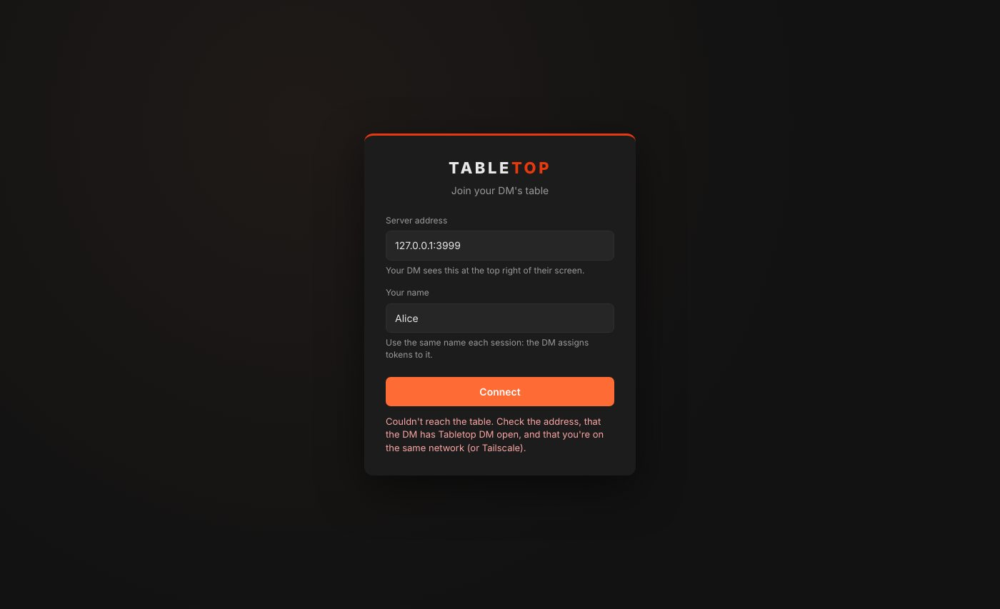

# Player guide

## Connect

1. Run `Tabletop-Player-Setup-<version>.exe` (no admin rights needed), choose where to install it and click **Install**, or unzip `Tabletop-Player-<version>-Windows.zip` anywhere and run **Tabletop Player.exe**.
   The first time, Windows says "Windows protected your PC": click **More info → Run anyway**.
2. Type the **server address** your DM gives you and **your name**, then click **Connect**. On the DM's network that looks like `192.168.1.20:3000`; from somewhere else it's the DM's internet address, like `41.10.20.30:3000`.
3. If the table has a passcode, the app asks for it: your DM can tell you it. The app remembers it for next time.
4. Use the **same name every session**. Your DM gives your token to that name, and your quick rolls are saved under it.

The app remembers the address and your name. **Table → Disconnect** (Ctrl+D) goes back to this screen.

**Updates:** when there's a new version the app says so; click **Update now** and it downloads and installs itself (or use **Help → Check for updates…**). New features of the table itself come from the DM's PC, so you get those as soon as your DM updates.

**"Couldn't reach the table"** means one of these: the address is wrong, the DM hasn't started Tabletop DM, the DM's firewall is blocking it, or, if you're on the DM's network, the DM's address has changed. From somewhere else, check you have the DM's internet address (they see it at the top right as **🌐 Online**).

## Play

- **Move your token** by dragging it. You can only move tokens the DM has given you. Scroll to zoom, right-drag to pan, Home fits the map to the screen.
- **Roll dice** with the buttons on the right, or type a roll like `1d20+5`, `2d6+3` or `4d6kh3` and press Roll.
- **Quick rolls:** add your attacks, saves and skills once under "My quick rolls" (e.g. name `Longsword hit`, roll `1d20+5`), copying the bonuses from your D&D Beyond sheet. Then click to roll. **Shift-click** for advantage, **Alt-click** for disadvantage.
- **Roll privately** sends the result only to the DM.
- **Your dice roll on screen** for everyone to see. **My dice…** (under the dice buttons) picks their look, or uses a picture of your own. The DM's rolls stay secret.
- **Spells:** with the **Spell** tool, pick an effect (fire, lightning, cold…) before placing a template and it goes off for everyone. Select one of yours and click **Cast** to set it off again.
- **Sound:** you hear the map from where your character stands: torches, water, doors, footsteps and blows. Under **🔊**, **Map sounds** sets how loud the torches, fires, water and lava are (0 turns them off), and **Effects** the dice, doors, blows and footsteps.

## Your character from D&D Beyond

1. On D&D Beyond, open your character and make it public: **Manage → Character Settings → Character Privacy → Public**.
2. Click **Share** on your character sheet and copy the link.
3. In Tabletop, paste it under **My character** and click **Bring in**.

You get your portrait, hit points, AC, speed, initiative and darkvision, and a button for every roll on your sheet: attacks (to hit and damage), ability checks, saving throws and skills. Shift-click rolls with advantage, Alt-click with disadvantage.

- **📍 Put my token on the map** places your token in the middle of your view. Click it again on another map to bring your character there, or after an update to refresh your token.
- **Spells:** your slots are pips (click to tick one off or back). Click a spell to open it: **Cast** spends a slot (pick a higher one to upcast), **As a ritual** spends none, and the buttons roll its attack, damage or healing. **◎ Area** gets its template ready to drag onto the map. **☾ Short rest** and **⛺ Long rest** bring slots (and on a long rest, hit points) back.
- **Healing, damage and protection go straight onto the map:** **Cast** a spell like Cure Wounds, Healing Word, Fireball or False Life, then click the tokens it's for (they get a dashed ring). **Me** adds your own token; **In my area** adds every token inside the area you placed. Click **Apply**: the slot is spent, the dice roll for everyone, and hit points change at once. Attack spells roll against each target's AC, save spells make each target save (half damage where the spell says so). `Esc` or **Cancel** stops without spending anything.
- **Darts, rays and beams** (Magic Missile, Scorching Ray, Eldritch Blast): click a token once for every dart or ray you send at it, Shift+click to take one back.
- **Spells with conditions** (Hold Person, Bless, Bane, Faerie Fire, Web…) put the condition on each target that fails its save. If you're concentrating and get hurt, Tabletop rolls your concentration save for you; if it fails, or you cast another concentration spell, the spell's conditions come off.
- **When a spell holds you** (Hold Person, Web…), your token shows which spell and how it ends. End-of-turn saves roll for you when the DM moves the turn on; for Web or Entangle, click **🪢 Try to break free** on your token when you use your action for it.
- **Attack with a weapon:** **🎯** next to it under Attacks, then click the target. Advantage, AC, critical hits, Bless, Hex and Hunter's Mark are worked out for you.
- **Spells that pick a damage type** (Chromatic Orb, Dragon's Breath) ask for it in the bar. Protections like Shield, Mage Armor, Stoneskin or Death Ward change your AC and damage as they should.
- **Features that make a creature save** (Stunning Strike, Cunning Strike, Turn Undead, Grapple, Shove…) are listed with their DC: click **🎯**, click the target, then **Apply**.
- **Your saving throws roll for you**, with Bless, Bane, Exhaustion, your Advantages from D&D Beyond, a paladin's aura nearby, and conditions that change them. At 0 hit points your death saves roll at the start of your turn.
- **Class features** such as Lay on Hands, Second Wind, Channel Divinity or Bardic Inspiration sit under **Class features**: click a pip to use one. **💛 Heal…** for Lay on Hands lets you pick who and how many hit points from your pool.
- **Coins and inventory** show your money, what you carry (and in which bag) and your spells by level.
- **↻ Update from D&D Beyond** after you level up, spend gold or change gear.
- Hit points you lose at the table stay at the table: they don't go back to D&D Beyond.

## What you'll see

- **Your turn:** in combat, a banner says whose turn it is, and a big one with a chime says when it's yours.
- **Places you've been** stay on your map in faded grey while your character can't see them; what you see by **darkvision** in the dark is in black and white.
- **Chests:** click one with the **Door** tool to open it.
- **Handouts** the DM shows fill your screen; click to close, and find them again under **Handouts**.

## Table tools

The bar on the left of the map:

- **Move** (`V`): drag your token. While dragging, it shows how far you've moved, and everyone sees it. Press `Space` mid-drag to go round a corner.
- **Ruler** (`R`): drag to measure in feet; `Space` adds a corner. Everyone sees your ruler.
- **Spell** (`T`): spell templates. Pick cone, sphere, cube, line or cylinder in the bar at the bottom, then drag from where the spell starts (or type the size and click). The squares it hits are shaded. Click one of yours to move it, drag its dot to aim or resize it, `Del` removes it. **Clear mine** removes all yours.
- **Door** (`D`): click a door you can see to open or close it.
- **Ping** (`P`): click to flash a spot for everyone ("over here!"). `Alt`+click pings with any tool.

`Esc` goes back to Move.

## Talking

- **Chat:** type in the box at the bottom right and press Enter. A speech bubble shows over your token.
- **Whisper:** pick someone under **To** (or the DM), or type `/w Bob let's sneak round the back`. Only they and the DM see it.
- `/r 1d20+5` rolls from the chat box.
- **Your character sheet:** click your token and paste your D&D Beyond character link. Then double-click your token (or 📜 Sheet) to open it.

## Protect your name

Click **Playing as …** at the top right and set a PIN (4 to 8 digits). Then nobody else can join as you. The app remembers your PIN; if you forget it, ask the DM to reset it.

## Seeing in the dark

When the DM turns vision on, you see only what your character can see: walls and closed doors block your view, and in a dark dungeon you see only what's lit. Click your token to set its **Light** (light a torch!) and **Darkvision** (if your character has it; it's on your D&D Beyond sheet). Open doors with the Door tool to see through them.

## Sound

The DM can play music and ambience (rain, a crackling fire, a tavern band) for the whole table. Click **🔊** at the top right to see what's playing and to set your own volume: everything, music and ambience separately, or **Mute**.

When the DM sets the weather (rain, snow, fog…) you'll see it over the map. If the moving weather bothers you, untick **Show moving weather** under **🔊**. If the map runs slowly on your PC, set **Map look** there to **Lit, nothing moving**, or **Classic**.

## Handouts

When the DM shows you a handout (a letter, a picture, a clue), it pops up on your screen. It stays under **Handouts** on the right; click it to read it again.

## In combat

- The **Initiative** list appears at the top right when the DM starts a fight. Click **🎲** next to your name to roll initiative, or type your score.
- Whose turn it is glows gold on the map and is highlighted in the list.
- **Click your token** to open your character's box: set your HP and max HP, temporary HP and initiative bonus, type an amount and press **Damage** or **Heal**, and toggle conditions like Concentrating or Prone.

- **Attack a target:** click **🎯** next to a weapon in My character, then the target. Tabletop rolls against its AC and takes the damage off. Cast spells with **Cast** and click the targets.
- **Actions:** select your token for **🛡 Dodge**, **🏃 Disengage**, **🤝 Help**, **🫥 Hide**, **💨 Dash** and **⏳ Ready**.
- **Rests:** spend Hit Dice from My character after a **☾ Short rest**.
- **Reactions:** when a foe leaves your reach, a card asks if you want to make an opportunity attack; when someone nearby casts a spell and you have Counterspell, a card asks if you want to counter it. Click a button or let it time out.
- **Summons:** creatures you summon appear next to you. Drag them, and attack with them from **Your summons** in My character. Misty Step and Dimension Door ask you to click where you appear.

## Items from the DM

Items the DM gives you appear under **From the DM** in My character. Use them from there: **🎯 Attack** with a weapon, **🧪 Drink** a potion (or **Give to…** someone else), **📜 Read** a scroll, **🪄 Use a charge** of a wand, **✨ Use on…** for a wondrous item, and **Wear** armour, shields, rings and cloaks so their AC and bonuses count.

## Your token's picture

Select your token and click **📷 Picture…** to use any picture as a round token. Drag it to frame your face, set the zoom and pick a frame.

Keep your character sheet in D&D Beyond as usual; Tabletop is for the map and the dice.
